# Projeto Final — Estatística Aplicada a Jogadores de Futebol


Projeto acadêmico das disciplinas de **Estatística I e II** (Especialização em Engenharia e Análise de Dados — **CESAR School**), desenvolvido pela **Equipe 04**.

O estudo aplica conceitos fundamentais e avançados de probabilidade, variáveis aleatórias discretas e contínuas, covariância, correlação de Pearson, análise de *outliers*, ajuste de distribuições paramétricas, normalização, **Teorema Central do Limite (TCL)** e **Intervalos de Confiança** sobre uma base de **17.898 jogadores profissionais de futebol** (`fifa_players.csv`).

---

## Sumário

1. [Visão Geral e Fluxo Analítico](#1-visão-geral-e-fluxo-analítico)
2. [Conjunto de Dados e Higienização](#2-conjunto-de-dados-e-higienização)
3. [Teoria das Probabilidades e Teorema de Bayes](#3-teoria-das-probabilidades-e-teorema-de-bayes)
4. [Variáveis Aleatórias Discretas e Contínuas](#4-variáveis-aleatórias-discretas-e-contínuas)
5. [Covariância, Correlação e o Efeito de Subgrupo (Goleiros)](#5-covariância-correlação-e-o-efeito-de-subgrupo-goleiros)
6. [Estatística Descritiva, Outliers e Distribuições Paramétricas](#6-estatística-descritiva-outliers-e-distribuições-paramétricas)
7. [Padronização vs. Normalização (`StandardScaler` vs. `MinMaxScaler`)](#7-padronização-vs-normalização-standardscaler-vs-minmaxscaler)
8. [Teorema Central do Limite (TCL) e Intervalos de Confiança](#8-teorema-central-do-limite-tcl-e-intervalos-de-confiança)
9. [Estrutura do Repositório](#9-estrutura-do-repositório)
10. [Como Executar](#10-como-executar)
11. [Equipe](#11-equipe)

---

## 1. Visão Geral e Fluxo Analítico

O notebook [`Projeto Final_Equipe 4.ipynb`](./Projeto%20Final_Equipe%204.ipynb) estrutura a investigação estatística em sete módulos complementares:

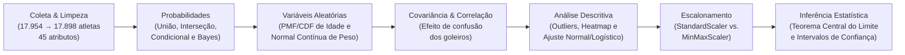

---

## 2. Conjunto de Dados e Higienização

- **Fonte:** Dataset `data-liga-premiere` (`fifa_players.csv`), obtido via `kagglehub`.
- **Tratamento Inicial:**
  - Remoção de colunas com excesso de valores ausentes ou artefatos de importação (`national_team`, `national_rating`, `Unnamed: 47`), reduzindo de 48 para **45 colunas**.
  - Remoção de 56 registros duplicados com base em `full_name`, consolidando **17.898 jogadores únicos**.

| Variável Analisada | Descrição | Tipo | Média ± Desvio-Padrão | Mín — Mediana — Máx |
| :--- | :--- | :-: | :-: | :-: |
| `overall_rating` | Avaliação geral do atleta (0 a 100) | `int64` | 66,24 ± 6,97 | 47,0 — 66,0 — 94,0 |
| `age` | Idade do jogador em anos | `int64` | 25,56 ± 4,70 | 17,0 — 25,0 — 46,0 |
| `weight_kgs` | Massa corporal em quilogramas | `float64` | 75,30 ± 7,08 | 49,9 — 74,8 — 110,2 |
| `stamina` | Resistência física (0 a 100) | `int64` | 63,13 ± 15,91 | 12,0 — 66,0 — 96,0 |
| `positioning` | Posicionamento tático ofensivo (0 a 100) | `int64` | 50,02 ± 19,69 | 2,0 — 55,0 — 95,0 |

---

## 3. Teoria das Probabilidades e Teorema de Bayes

A partir dos eventos $B = \text{``Jogador Brasileiro''}$ (`nationality == "Brazil"`) e $C = \text{``Jogador Canhoto''}$ (`preferred_foot == "Left"`) no espaço amostral de $N = 17.898$ atletas:

| Operação Probabilística | Expressão Matemática | Resultado Empírico | Interpretação |
| :--- | :---: | :---: | :--- |
| **Probabilidade Simples** | $P(B)$ | **4,65%** | Proporção de atletas brasileiros na base global |
| **Probabilidade da União** | $P(B \cup C) = P(B) + P(C) - P(B \cap C)$ | **26,58%** | Probabilidade de ser brasileiro **ou** canhoto |
| **Probabilidade da Interseção** | $P(B \cap C)$ | **1,31%** | Probabilidade de ser simultaneamente brasileiro **e** canhoto |
| **Complemento / Diferença** | $P(B \cap C^c) = P(B) - P(B \cap C)$ | **3,34%** | Probabilidade de ser brasileiro e destro |
| **Diferença Assimétrica** | $P(C \cap B^c)$ | **21,94%** | Probabilidade de ser canhoto e não brasileiro |
| **Probabilidade Condicional** | $P(B \mid C) = \frac{P(B \cap C)}{P(C)}$ | **5,62%** | Sabendo que o atleta é canhoto, chance de ser brasileiro |
| **Teorema de Bayes** | $P(C \mid B) = \frac{P(C) \cdot P(B \mid C)}{P(B)}$ | **28,12%** | Sabendo que o atleta é brasileiro, chance de ser canhoto |

---

## 4. Variáveis Aleatórias Discretas e Contínuas

### 4.1. Variável Discreta: Função de Probabilidade (PMF) e Repartição (CDF) da Idade
A distribuição etária (`age`) concentra-se entre 20 e 28 anos, atingindo seu pico aos **21–24 anos**, com a função acumulada $F(x) = P(\text{Age} \le x)$ convergindo para 100% próximo aos 40 anos:

| Função de Probabilidade $P(X = x)$ | Função de Repartição Acumulada $F(x) = P(X \le x)$ |
| :-: | :-: |
| 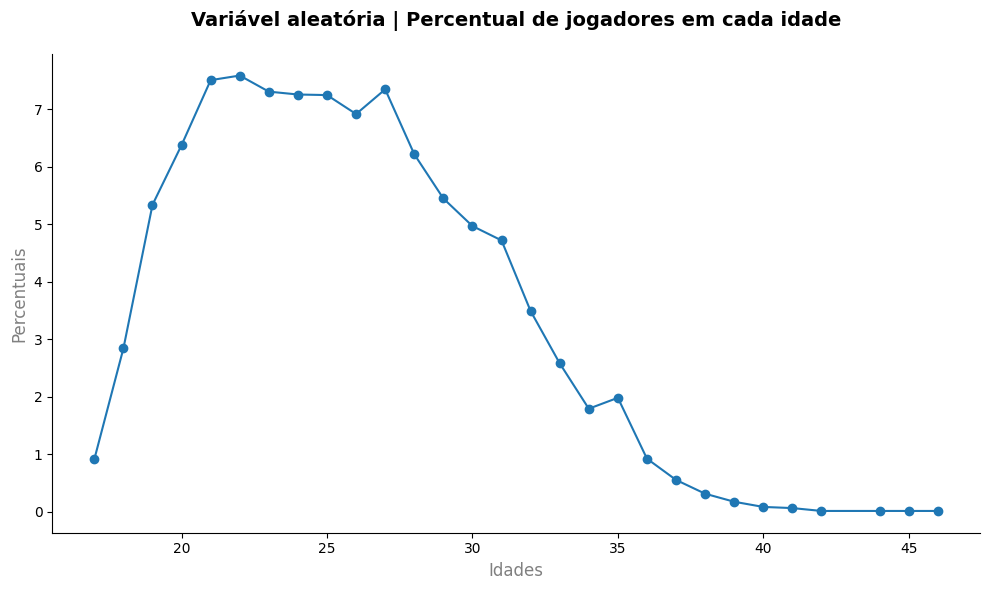 | 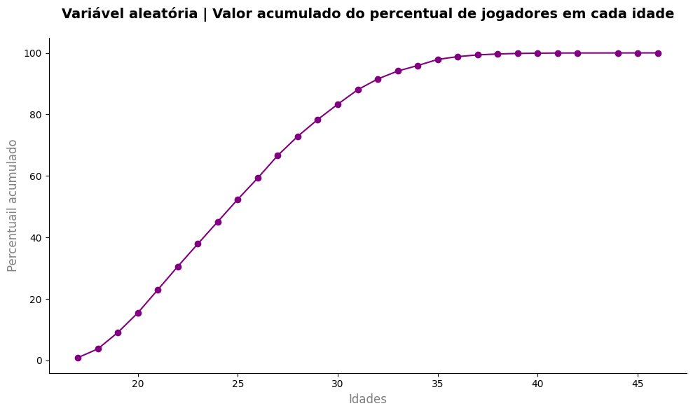 |

### 4.2. Variável Contínua: Distribuição Normal de Peso (`weight_kgs`)
Modelando o peso corporal como $X \sim \mathcal{N}(\mu = 75{,}30\text{ kg},\, \sigma = 7{,}08\text{ kg})$, calculou-se via CDF gaussiana (`scipy.stats.norm.cdf`) a probabilidade de um jogador selecionado ao acaso pesar entre **50 kg e 87 kg**:

$$P(50 \le X \le 87) = \Phi\left(\frac{87 - 75{,}30}{7{,}08}\right) - \Phi\left(\frac{50 - 75{,}30}{7{,}08}\right) = \mathbf{95{,}06\%}$$

---

## 5. Covariância, Correlação e o Efeito de Subgrupo (Goleiros)

Ao investigar a relação linear entre **resistência física (`stamina`)** e **posicionamento (`positioning`)**:

1. **Base Completa ($N = 17.898$):**
   - $\text{Cov}(\text{stamina}, \text{positioning}) = +205{,}71$
   - Correlação de Pearson: **$r = 0{,}6567$** (aparentemente moderada/forte).
2. **Identificação de Subgrupo Confundidor (*Goleiros*):**
   - O gráfico de dispersão revela um agrupamento isolado no canto inferior esquerdo correspondente aos **goleiros (`GK`)**, que possuem simultaneamente baixa `stamina` e baixo `positioning` de linha.
3. **Base Sem Goleiros (Jogadores de Linha):**
   - Ao filtrar os goleiros, a correlação cai drasticamente para **$r = 0{,}2724$** (fraca), demonstrando como um subgrupo distinto pode inflar artificialmente o coeficiente de correlação global.

| Com Goleiros ($r = 0{,}6567$) | Sem Goleiros ($r = 0{,}2724$) |
| :-: | :-: |
| 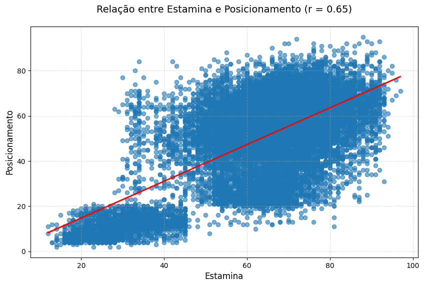 | 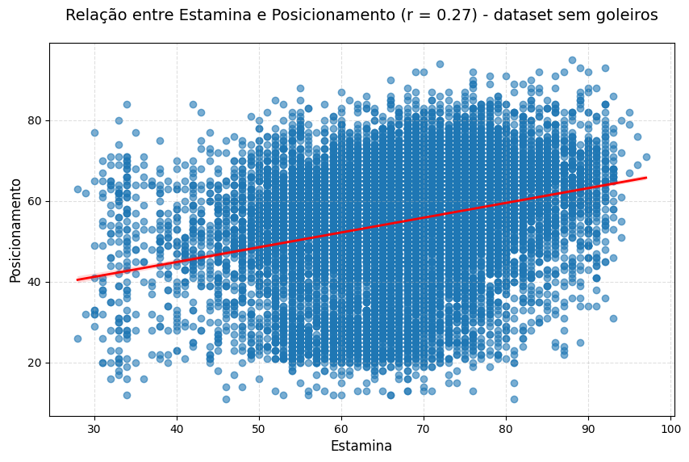 |

---

## 6. Estatística Descritiva, Outliers e Distribuições Paramétricas

- **Detecção de Outliers em `overall_rating`:** Pela regra do intervalo interquartil ($\text{IQR}$), apenas **162 de 17.898 jogadores (0,91%)** configuram *outliers* superiores ou inferiores, evidenciando alta concentração em torno da mediana (66,0).
- **Relações Físicas e Técnicas:**
  - Forte relação positiva entre **aceleração (`acceleration`)** e **velocidade final (`sprint_speed`)** entre jogadores de linha.
  - Na matriz de correlação de atributos técnicos, **drible (`dribbling`)** apresenta correlação de **$r = 0{,}85$** com **chutes de longa distância (`long_shots`)**, superior à correlação entre agilidade (`agility`) e chutes de longe ($r = 0{,}65$).
- **Ajuste de Distribuições:** O histograma de `overall_rating` é bem descrito tanto pela **Distribuição Normal** quanto pela **Distribuição Logística**.

| Aceleração vs. Sprint (Sem Goleiros) | Correlação: Drible, Agilidade e Chute de Longe | Ajuste Normal vs. Logístico (`overall_rating`) |
| :-: | :-: | :-: |
| 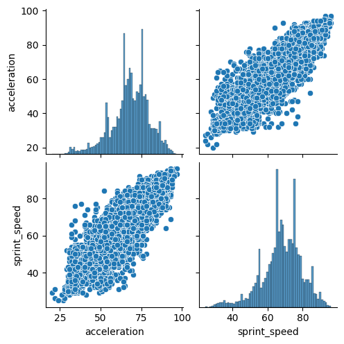 | 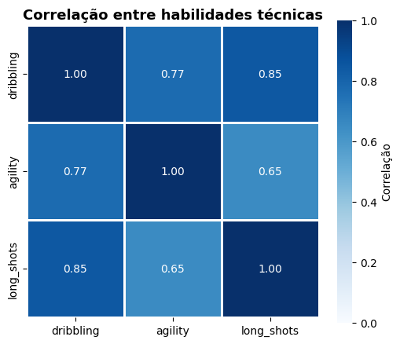 | 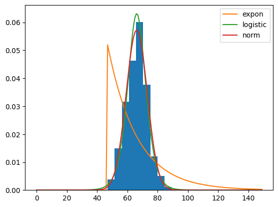 |

---

## 7. Padronização vs. Normalização (`StandardScaler` vs. `MinMaxScaler`)

Aplicando `StandardScaler` ($z = \frac{x - \mu}{\sigma}$, intervalo aproximado $[-2, 4]$) e `MinMaxScaler` ($x' = \frac{x - x_{\min}}{x_{\max} - x_{\min}}$, intervalo $[0, 1]$) à variável `age`, comprova-se visualmente que transformações lineares alteram **apenas a escala do eixo horizontal**, preservando intacta a **forma e a assimetria** da distribuição original:

| Original (Anos) | `StandardScaler` ($\mu=0, \sigma=1$) | `MinMaxScaler` ($[0, 1]$) |
| :-: | :-: | :-: |
|  |  | 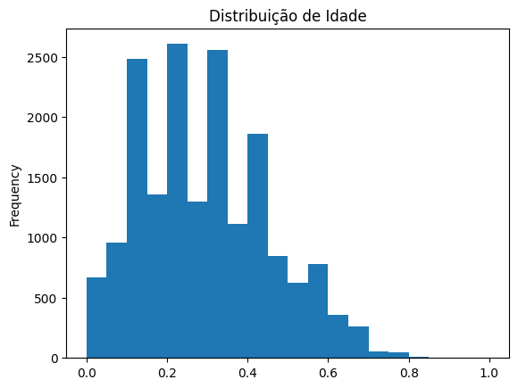 |

---

## 8. Teorema Central do Limite (TCL) e Intervalos de Confiança

### 8.1. Demonstração Empírica do Teorema Central do Limite
Extraindo repetidas amostras aleatórias da variável `age` com tamanhos amostrais $n \in \{1, 5, 30, 100\}$, verifica-se que, conforme $n$ cresce, a distribuição das médias amostrais ($\bar{X}_n$) converge para uma **Distribuição Normal** centrada na média populacional e com dispersão cada vez menor ($\sigma_{\bar{X}} = \sigma / \sqrt{n}$):

| $n = 1$ | $n = 5$ | $n = 30$ | $n = 100$ |
| :-: | :-: | :-: | :-: |
| 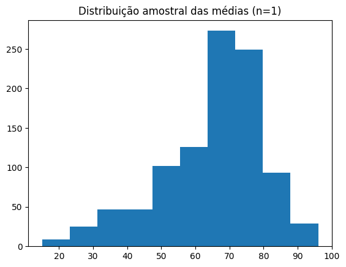 | 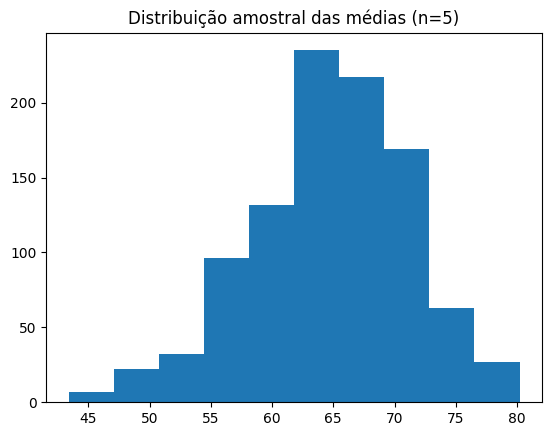 | 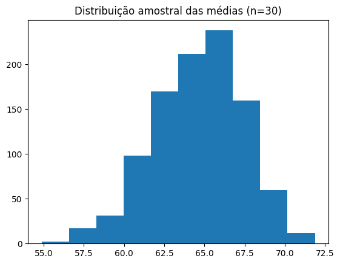 | 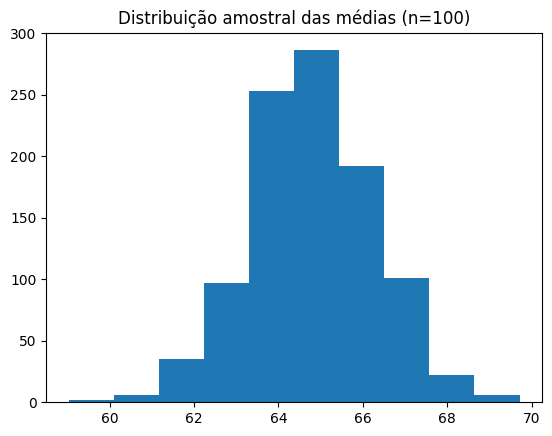 |

### 8.2. Intervalos de Confiança para `overall_rating` ($n = 100$)
Para uma amostra de $n = 100$ jogadores com média amostral $\bar{x} = 66{,}24$ e erro padrão $EP = \frac{s}{\sqrt{n}} = 0{,}6966$:
- **Intervalo de Confiança a 90% ($\alpha = 0{,}10$):** $\text{IC}_{90\%} = \mathbf{[65{,}09\,;\; 67{,}38]}$
- **Intervalo de Confiança a 95% ($\alpha = 0{,}05$):** $\text{IC}_{95\%} = \mathbf{[64{,}87\,;\; 67{,}60]}$

---

## 9. Estrutura do Repositório

```text
├── assets/                                            # Gráficos extraídos do estudo estatístico
│   ├── ajuste_distribuicao_overall.png
│   ├── dispersao_aceleracao_sprint.png
│   ├── estamina_posicionamento_com_goleiros.png
│   ├── estamina_posicionamento_sem_goleiros.png
│   ├── funcao_probabilidade_idade.png
│   ├── funcao_reparticao_idade.png
│   ├── heatmap_correlacao_atributos.png
│   ├── idade_minmaxscaler.png
│   ├── idade_original.png
│   ├── idade_standardscaler.png
│   └── tlc_n1.png / tlc_n5.png / tlc_n30.png / tlc_n100.png
├── Projeto Final_Equipe 4.ipynb                       # Notebook principal com todas as análises e códigos
├── .gitignore                                         # Regras de exclusão para arquivos locais e credenciais
├── requirements.txt                                   # Dependências Python
└── README.md                                          # Documentação detalhada do estudo
```

---

## 10. Como Executar

Recomendado: **Python 3.10** ou superior.

1. Clone este repositório e acesse a pasta:
   ```bash
   git clone https://github.com/pepsbr/projeto-final-estatisticas-jogadores-futebol.git
   cd projeto-final-estatisticas-jogadores-futebol
   ```
2. Crie e ative um ambiente virtual:
   ```bash
   python -m venv .venv
   .\.venv\Scripts\Activate.ps1
   ```
3. Instale as dependências:
   ```bash
   python -m pip install -r requirements.txt
   ```
4. Execute o Jupyter Notebook:
   ```bash
   jupyter notebook "Projeto Final_Equipe 4.ipynb"
   ```
   > **Nota:** A primeira célula utiliza `kagglehub` para baixar automaticamente o dataset `data-liga-premiere` (`fifa_players.csv`).

---

## 11. Equipe

Trabalho desenvolvido pela **Equipe 04** — CESAR School:

- **Mauro Roberto Barbosa Cahu**
- **Pedro Paulo Sant'Anna Belo Ramos**
- **Renato Vasconcellos Bittencourt Neto**
- **Vinicius Dantas Batista da Silva**

---

## Data do Projeto

Data informada para o projeto: **07/08/2026**. A data de criação que o GitHub exibe para o repositório corresponde à criação real na plataforma.
